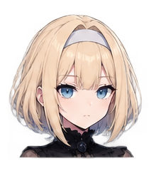
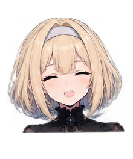
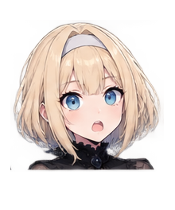
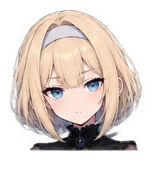
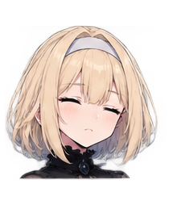
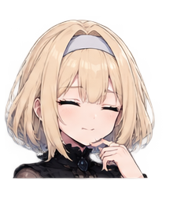
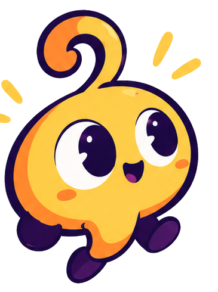

<h1 align="center">¡Soy Patrick!</h1>

  <strong>Backend con Python. Interfaces con React. Curiosidad por Rust.</strong> 
  Desarrollo de software desde Buenaventura, Colombia.

  <a href="https://linkedin.com/in/axwyk">LinkedIn</a> ·
  <a href="mailto:jpmay1117@gmail.com">Correo</a> ·
  <a href="https://axwyk.github.io">Portafolio</a>

## Sobre mí

Soy **Patrick**, aunque en internet soy **Axwyk**. Curso sexto semestre de Tecnología en Desarrollo de Software en la **Universidad del Valle, Sede Buenaventura**.

Me gusta el backend: modelar datos, diseñar APIs que tengan sentido y entender por qué algo decidió fallar a las 2 a. m. También me gusta que lo que construyo se vea bien, así que termino entrando al frontend más de lo planeado, estoy aprendiendo practicas DevOps, QA.

Ahora construyo **Alice 2.0** y **NOSE**, colaboro en **VINTRA** y sigo aprendiendo **Rust, Axum y Docker**. Estoy buscando **prácticas profesionales en desarrollo de software**, con especial interés en backend.

## Proyectos

###  Alice

**Un asistente de escritorio con personalidad en construcción.** 
Proyecto personal · Alice 2.0 en desarrollo

Alice 2.0 combina una interfaz en **React y TypeScript** con lógica en **Rust**, conectadas mediante IPC con **Tauri**.

- El chat ya funciona de punta a punta con respuestas de demostración generadas en Rust y validación de mensajes en el backend.
- La IA real, la memoria con SQLite, la voz y la integración del avatar quedan para próximas etapas: primero la tubería, después el cerebro.

Todavía no tiene un modelo de IA conectado, pero ya tiene siete expresiones para cuando llegue el momento.

Las siete caras de Alice

  
  
  
  
  
  
  

`Rust` `Tauri` `React` `TypeScript` `Vite` `Tailwind CSS`

[Repositorio de Alice](https://github.com/Axwyk/Alice)

###  NOSE

**Del «no sé» al «ya sé».** 
Proyecto personal

Una app para esa pregunta que puede alargar cualquier plan: «¿y ahora qué hacemos?». NOSE reúne recomendaciones en tres frentes:

- **Qué Comer:** para resolver el antojo.
- **Qué Ver:** para pasar menos tiempo eligiendo que viendo.
- **Qué Hacer:** para que el plan salga del chat.

Nosito, la mascota amarilla junto al título, pone la cara. La idea es que decidir deje de ser la parte más difícil del plan.

###  VINTRA

**Mejor información para coordinar la recolección en Buenaventura.** 
Proyecto académico · Trabajo en equipo · En desarrollo

VINTRA nació de un diagnóstico en clase: la falta de coordinación de rutas y de información sobre el paso del recolector afecta tanto al operador como a la ciudadanía.

La plataforma busca conectar tres roles:

- **Operador:** planificar rutas, asignar conductores y seguir los vehículos.
- **Conductor:** iniciar recorridos, compartir su ubicación y reportar novedades.
- **Ciudadanía:** consultar horarios, recibir avisos y reportar residuos sin recoger.

Trabajamos por células, con ramas por funcionalidad y PostgreSQL como base de datos.

`PostgreSQL` `API REST` `GitHub Actions` `Git`

[Repositorio de VINTRA](https://github.com/Univalle-P-I/VINTRA)

###  Vialtros

**Usuarios, conductores y rutas en una misma plataforma.** 
Proyecto académico · Trabajo en equipo

Una plataforma de gestión y seguimiento para el sector transporte. Mi aporte se centró en conectar las piezas:

- Desarrollé módulos de backend para usuarios, conductores y rutas, expuestos como API REST.
- Construí e integré componentes en React.
- Configuré el despliegue por SSH y trabajé con Git de forma colaborativa. Sí, también hubo conflictos de merge.

`Python` `Django` `Django REST Framework` `React` `PostgreSQL` `Git`

[Repositorio de Vialtros](https://github.com/Vialtros-ORG/Vialtros)

## Tecnologías

**Backend y datos**

**Interfaces y escritorio**

**Herramientas**

**En aprendizaje**

## Hablemos

Si tienes una oportunidad de prácticas, un proyecto o ganas de conversar sobre backend e IA local, puedes encontrarme en [LinkedIn](https://linkedin.com/in/axwyk) o escribirme a [jpmay1117@gmail.com](mailto:jpmay1117@gmail.com).
